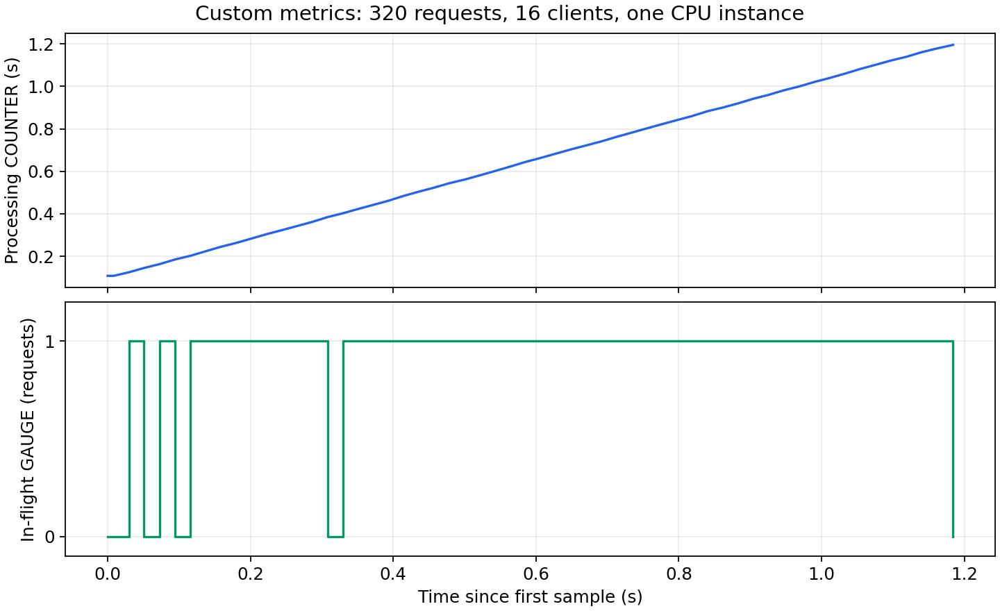
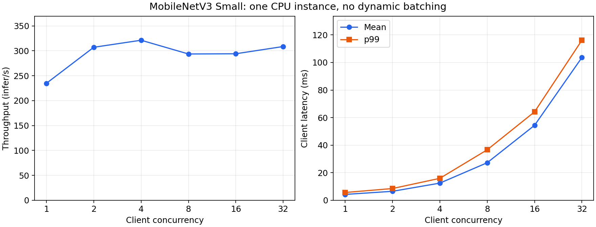
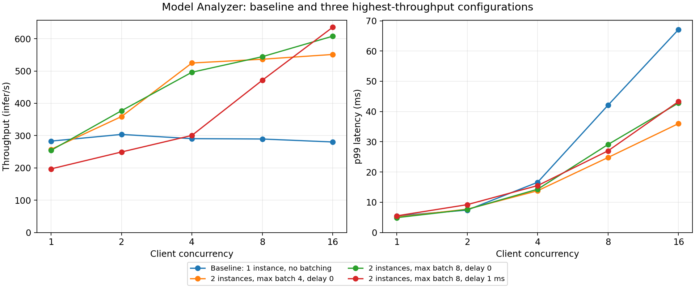

# Домашнее задание 3: инференс модели в Triton

Предобученная MobileNetV3 Small классифицирует изображения на 1000 классов ImageNet. Triton обслуживает HTTP и gRPC через Python backend; внутри него выполняется PyTorch TorchScript. Есть две кастомные метрики, клиентские проверки, Performance Analyzer и конфигурация поиска Model Analyzer.

**Статус:** полный запуск успешно завершён: проверены HTTP/gRPC и обе кастомные метрики, получены замеры Performance Analyzer, Model Analyzer сравнил 13 конфигураций и сформировал отчёты. Найден вариант с throughput 635.5 infer/s — на 126.8% выше исходного при той же concurrency=16. Все цифры ниже взяты из сохранённых артефактов успешного запуска.

## Требования и выбор решения

- Linux x86_64, Docker с Compose v2, рекомендуются 8 ГБ RAM и 30 ГБ свободного диска.
- Для сборки нужен интернет: NGC, PyPI, download.pytorch.org. После сборки веса находятся в образе; при старте скачивание не требуется.
- GPU не нужен: используется `KIND_CPU`, один поток PyTorch на экземпляр модели. На Apple Silicon в Compose указана эмуляция `linux/amd64`, но её работоспособность не проверена; замеры для отчёта предполагаются на Linux x86_64.
- Базовый образ `nvcr.io/nvidia/tritonserver:23.12-py3`, NumPy `1.26.4`, PyTorch `2.1.2+cpu`, torchvision `0.16.2+cpu`, клиент `2.41.0`, Model Analyzer `1.35.0`. Прямые зависимости фиксированы в requirements-файлах; полный список установленных зависимостей сохраняется при профилировании.

Python backend позволяет разместить метрики непосредственно в модели. Дополнительная BLS-прокси не требуется. MobileNet выбрана как небольшой настоящий классификатор, пригодный для CPU; обучение с нуля не относится к цели задания.

Проверить Linux-машинку с SSH-алиасом `one-vm` из локального терминала:

```bash
bash scripts/check_vm.sh
```

Проверка показывает архитектуру, CPU, RAM, свободное место, Docker/Compose и доступность HTTPS-источников сборки. Она не устанавливает пакеты и не запускает контейнеры; результат записывается в `results/vm_preflight.txt`. HTTP 401 от `nvcr.io/v2/` ожидаем без получения registry token. Успешная проверка сети не гарантирует загрузку всех слоёв и весов: это проверяется сборкой.

Если общий адрес реестра возвращает ошибку, отдельно проверьте метаданные именно нужных образов, без скачивания слоёв:

```bash
bash scripts/check_registry.sh
```

Результат сохранится в `results/registry_check.txt`. Ошибка от общего `/v2/` сама по себе не доказывает недоступность конкретных образов; до сборки нужно проверить их manifests.

Для сравнения доступа из терминала и Docker выполните на Mac `python3 scripts/diagnose_registry.py`. Скрипт проверяет HTTPS, настройки прокси и manifests обоих образов; образы не скачиваются. Успешный `docker manifest inspect` проверяет доступ к manifest из Docker CLI; скачивание слоёв через Docker daemon требует отдельной проверки.

Если образы доступны с Mac, их можно скачать там и передать на VM через `docker save`/`docker load`. Из обычного терминала Mac в папке проекта:

```bash
bash scripts/run_on_vm.sh
```

Скрипт сначала использует уже имеющиеся на VM образы либо скачивает их напрямую. При недоступности реестра с VM он скачивает **большие образы** для `linux/amd64` через локальный Docker Desktop и передаёт их по SSH. Если реестр недоступен и с Mac, выполнение остановится до передачи кода и запуска модели.

Затем код передаётся в новый каталог `/tmp/hw3-run-<идентификатор>`, сборка и замеры выполняются на Linux, а логи/CSV/отчёты возвращаются в локальный `results/vm_run_<идентификатор>/`. Существующие удалённые каталоги не перезаписываются. Для запуска нужны свободные порты 8000–8002. Проверен shell-синтаксис скрипта; полный запуск ещё не выполнен.

В случае ошибки сборки или проверки скрипт забирает доступные результаты и сохраняет ненулевой exit status. Копии весов и checkpoints остаются на VM для последующего выбора конфигурации; в локальный каталог возвращаются компактные результаты. Повторное профилирование финального варианта выполняется после анализа этих результатов.

Перенос образов через архив документирован в [Docker save](https://docs.docker.com/reference/cli/docker/image/save/) и [инструкции NVIDIA по загрузке образов на машину без доступа к реестру](https://docs.nvidia.com/dgx/dgx-os-8-user-guide/latest/appendix_g_installing_docker_containers.html).

## Запуск одной командой

Из корня проекта:

```bash
docker compose up --build -d --wait triton
```

Для последовательного запуска сервера, проверки HTTP/gRPC, метрик, Performance Analyzer и Model Analyzer:

```bash
bash scripts/run_all.sh
```

Скрипт сохраняет логи и результаты в `results/` и останавливается при первой ошибке. Перед независимым повторным экспериментом перенесите предыдущие результаты в другой каталог. По завершении Model Analyzer сервер остаётся остановленным. Выбранная конфигурация и сравнительный анализ приведены ниже; независимый повторный замер позволяет дополнительно проверить устойчивость результата.

Оба образа собираются до замеров. При сборке профилировщика `scripts/validate_analyzer_config.py` проверяет YAML штатным парсером установленного Model Analyzer 1.35.0, без запуска профилирования. Такая же проверка выполняется перед отдельным запуском Model Analyzer; её вывод сохраняется в `results/model_analyzer/validation.log`. Для CPU-профилирования используется `cpu_only: true`; параметр `dcgm_disable` эта версия не поддерживает.

На Mac ARM64 можно попробовать этот же скрипт в обычном терминале с работающим Docker Desktop: Compose уже задаёт `linux/amd64` для всех контейнеров. Docker Desktop [поддерживает эмуляцию](https://docs.docker.com/build/building/multi-platform/), но весь стек Triton/PyTorch/Model Analyzer на этом Mac пока не проверен. В отчёте такие замеры нужно обозначить как CPU-инференс в виртуальной машине с эмуляцией x86_64 на Apple Silicon.

Dockerfile скачивает предобученные веса, экспортирует их в TorchScript и сравнивает экспорт с исходной моделью на батчах 1, 4 и 8. Затем контейнер запускает `tritonserver` из `ENTRYPOINT`. Первая сборка может занять несколько минут.

```bash
docker compose ps
docker compose logs triton
curl -f http://localhost:8000/v2/health/ready
curl -f http://localhost:8000/v2/models/mobilenet/ready
curl -f http://localhost:8000/v2/models/mobilenet
```

Порты: `8000` — HTTP, `8001` — gRPC, `8002` — Prometheus. Модель должна иметь статус `READY`. Для остановки:

```bash
docker compose down
```

Можно использовать Docker напрямую:

```bash
docker build --platform linux/amd64 -t hw3-triton:23.12 .
docker run --rm --shm-size=1g -p 8000:8000 -p 8001:8001 -p 8002:8002 hw3-triton:23.12
```

## Запуск на GitHub Actions

Для профилирования на временной Linux x86_64 машине подготовлен `.github/workflows/profile.yaml`. Он запускает тот же `scripts/run_all.sh`: сборку, HTTP/gRPC проверки, проверку метрик, Performance Analyzer и Model Analyzer. Доступ к базовым образам проверяется в начале workflow. Полный успешный запуск подтверждён артефактами в `results/github_success_20261012`.

1. Создайте публичный репозиторий GitHub и загрузите исходники, включая `.github/workflows/profile.yaml`, в основную ветку. Архив исходников без презентаций, локальных диагностик и весов создаётся командой `python3 scripts/package_source.py`; результат — `results/source.zip`. Для загрузки в Git архив сначала нужно распаковать.
2. Откройте **Actions → Triton CPU profiling → Run workflow**. Автоматического запуска при каждом push нет.
3. После завершения скачайте artifact `triton-cpu-results-<run_id>`. Распакуйте ZIP, а затем `profiling-results.tar.gz` в отдельный каталог: `mkdir -p results/github_run && tar -xzf /путь/к/profiling-results.tar.gz -C results/github_run`.
4. Для анализа доступны `results/github_run/results/run.log`, `performance.md`, результаты метрик, CSV/отчёты Model Analyzer и `configurations/` с конфигурациями вариантов. Даже при ошибке сохраняются доступные результаты; наличие artifact само по себе не означает успешного профилирования.

Временная машина освобождает место от ненужных для задания предустановленных инструментов, проверяет минимум 30 ГиБ свободного места и сохраняет фактические характеристики в `runner.txt`. Архив результатов не включает большие копии весов. Artifact хранится 7 дней: скачайте его и добавьте измерения и отчёт в итоговый репозиторий.

Замеры нужно описывать как **CPU-инференс на GitHub-hosted runner**, с характеристиками из `runner.txt`. Сравнивать конфигурации следует внутри одного запуска; различия аппаратуры между запусками могут влиять на результаты. Независимый повторный замер выбранного варианта позволяет проверить устойчивость результата.

Использование стандартных hosted runners бесплатно для публичных репозиториев согласно [документации GitHub](https://docs.github.com/en/actions/reference/runners/github-hosted-runners). Порядок скачивания результатов описан в [документации artifacts](https://docs.github.com/en/actions/how-tos/manage-workflow-runs/download-workflow-artifacts).

## Контракт и клиентские запросы

Вход `IMAGE`: FP32, форма `[B, 3, 224, 224]`, `1 <= B <= 8`. Выход `LOGITS`: FP32, `[B, 1000]`. Размерность батча не указывается в `dims` конфигурации, потому что её добавляет Triton при `max_batch_size > 0`.

Для настоящей картинки клиент преобразует её в RGB, изменяет меньшую сторону до 256, выполняет центральный кроп 224×224 и нормализует каналы с ImageNet mean/std. `softmax` и top-5 считаются на клиенте. Сервер принимает уже подготовленный тензор, а не JPEG.

Примеры запросов с воспроизводимым синтетическим входом и сравнением с локальной моделью:

```bash
docker compose --profile tools run --rm client clients/infer.py --protocol http --url triton:8000 --verify
docker compose --profile tools run --rm client clients/infer.py --protocol grpc --url triton:8001 --batch-size 4 --verify
docker compose --profile tools run --rm client clients/smoke.py
```

`smoke.py` проверяет оба протокола, батчи 1/4/8, совпадение логитов с локальным инференсом (`rtol=atol=1e-4`), отказ на неправильную форму входа и корректный ответ после такого отказа. Ожидаемые сообщения — `Remote/local logits match` и `PASS ...`. Это ожидаемые условия проверки, а не зафиксированный результат запуска.

Для классификации своей картинки положите файл в `examples/photo.jpg`:

```bash
docker compose --profile tools run --rm client clients/infer.py --url triton:8000 --image /examples/photo.jpg --verify
```

Синтетический вход проверяет инференс и протокол; вывод top-5 на шуме не оценивает качество классификации. Для примеров реальной классификации сохраните вывод на своих изображениях в итоговом отчёте.

## Кастомные метрики

| Метрика | Тип | Смысл |
| --- | --- | --- |
| `hw3_processing_seconds_total` | COUNTER | Сумма времени процессинга запросов в секундах |
| `hw3_inflight_requests` | GAUGE | Число запросов, выполняемых внутри `execute` |

Время измеряется `time.perf_counter()`: от входа в `execute` до формирования ответов. Оно включает объединение тензоров, инференс и разбиение ответов. Ожидание в очереди Triton и клиентская предобработка не включаются. При динамическом батчинге все запросы разделяют интервал процессинга: для N запросов в COUNTER добавляется `N × elapsed`. Это сумма request-seconds, которая может превышать прошедшее календарное время; для загрузки устройства используются штатные метрики.

GAUGE считает **запросы**, а не изображения в клиентском батче. Для каждого синхронного экземпляра он равен `len(requests)` во время выполнения и возвращается к нулю в `finally`, в том числе при исключении. Очередь не включена: gauge может быть меньше клиентской concurrency. Метрики имеют labels `model`, `version`, `instance`; instance — PID процесса Python backend, поскольку API версии 23.12 не предоставляет имя экземпляра. Для общего значения нужно суммировать экземпляры.

```bash
curl -f http://localhost:8002/metrics
docker compose --profile tools run --rm client clients/check_metrics.py --url triton:8000 --metrics-url http://triton:8002/metrics
```

Проверка создаёт 16 параллельных клиентов по 20 запросов, опрашивает метрики во время нагрузки и сохраняет `results/metrics/samples.csv` и `summary.json`. Успех: прирост counter > 0, наблюдаемый максимум gauge > 0, gauge после завершения = 0. Если короткий инференс не попал в интервалы опроса, увеличьте `--requests-per-worker`; искусственной задержки в модели нет.

Примеры PromQL:

```promql
sum(hw3_inflight_requests)
sum(rate(hw3_processing_seconds_total[1m]))
```

## Performance Analyzer

Сервер и SDK-контейнер находятся в одной сети Compose. SDK обращается к `triton:8000`; это предусмотренная заданием альтернатива `--net host`.

```bash
docker compose --profile tools run --rm perf
python3 scripts/perf_report.py results/perf_analyzer/baseline
```

Скрипт запускает `perf_analyzer -m mobilenet` с concurrency 1/2/4/8/16/32, HTTP, клиентским батчем 1, окнами измерения 15 секунд и максимум 20 попытками. Стабильность проверяется по throughput и **средней задержке**, с допустимой вариацией 10%; p99 также измеряется и попадает в отчёт, но не используется как критерий остановки. Каждая точка сохраняется отдельными `.log` и `.csv` в `results/perf_analyzer/baseline/`; настройки сохраняются в `settings.txt`. При нестабильном результате или ошибке команда завершается с ненулевым кодом. Входы генерирует Performance Analyzer; оценивается производительность обслуживания тензоров, без загрузки JPEG и клиентской предобработки.

Каждый экземпляр модели выполняет 10 прогревочных инференсов с нулевым тензором при инициализации, до перехода в READY. Прогрев не учитывается в кастомных метриках запросов. Model Analyzer использует те же параметры стабильности и длительность окон. p99 отражает задержки в хвосте распределения; стабильность среднего значения сама по себе не гарантирует стабильность p99. Перед выбором конфигурации нужно сравнить повторные замеры. Назначение параметров описано в [документации Performance Analyzer](https://docs.nvidia.com/deeplearning/triton-inference-server/user-guide/docs/perf_analyzer/docs/cli.html).

Скрипт `perf_report.py` читает фактические значения из логов и переводит задержки из микросекунд в миллисекунды. Без замеров он выдаёт ошибку. Скопируйте выведенную таблицу в раздел результатов. Перед тестированием завершите клиентские проверки; они могут влиять на измерения.

## Model Analyzer

Отдельный target Dockerfile расширяет **тот же серверный образ**, устанавливает Model Analyzer через pip и содержит Performance Analyzer из SDK того же релиза. `triton_launch_mode: local` запускает `tritonserver` внутри этого контейнера с доступом к PyTorch и весам. Docker socket не нужен.

Для зависимостей `tritonclient[all]`, которые устанавливает Model Analyzer, зафиксирован `cuda-python==12.3.0`: версия 13 удаляет старые пространства имён CUDA API согласно [release notes NVIDIA](https://nvidia.github.io/cuda-python/cuda-bindings/latest/release/13.0.0-notes.html). Это зависимость инструментов; вычисления модели выполняются на CPU. При сборке образ проверяет запуск SDK через `perf_analyzer --version`, импорт CUDA shared-memory модуля клиента и загрузку CLI Model Analyzer. `scripts/run_all.sh` собирает оба образа до начала измерений.

Сначала завершите сервер, чтобы не создавать конкуренцию за CPU:

```bash
docker compose stop triton
docker compose --profile tools build analyzer
docker compose --profile tools run --rm analyzer
```

Конфигурация `profiling/model_analyzer.yaml` задаёт ручной перебор:

| Параметр | Значения |
| --- | --- |
| `max_batch_size` | 1, 4, 8 |
| `instance_group.count` | 1, 2 CPU-экземпляра |
| `max_queue_delay_microseconds` | 0, 1000 |
| Клиентская concurrency | 1, 2, 4, 8, 16 |
| Клиентский batch size | 1 |

В успешном запуске проверены 12 конфигураций × 5 уровней нагрузки и исходная конфигурация на тех же пяти уровнях: всего 65 измерений. У всех перебираемых вариантов включён dynamic batching; исходный `config.pbtxt` его не включает. `max_batch_size=1` позволяет оценить поведение планировщика без объединения разных запросов.

Цель поиска — throughput. Явного latency budget нет, поэтому победитель по throughput может иметь неприемлемую p99: решение о финальной конфигурации принимается после изучения обеих величин. Ожидаемые гипотезы, которые нужно подтвердить замерами: несколько экземпляров могут использовать разные CPU-ядра; batching может уменьшить расходы на вызов модели; задержка накопления может увеличить p99 при малой нагрузке. Улучшение заранее не гарантируется.

Результаты сохраняются в `results/model_analyzer/`: логи `profile.log`/`report.log`/`triton.log`, окружение, CSV, summary-отчёты, подробные отчёты, checkpoints и репозиторий вариантов. Скрипт генерирует подробные отчёты для всех найденных конфигураций. Имена вариантов находятся в `config_names.txt`. Для отдельного повторного отчёта выберите реальные имена из этого файла:

```bash
docker compose --profile tools run --rm --entrypoint model-analyzer analyzer report \
  --report-model-configs mobilenet_config_default,mobilenet_config_0 \
  --checkpoint-directory /results/model_analyzer/checkpoints \
  --export-path /results/model_analyzer
```

Имена выше — пример синтаксиса; замените их именами, сгенерированными вашим запуском. Не удаляйте checkpoints до генерации отчётов. Для повторного независимого эксперимента переименуйте каталог `results/model_analyzer`, чтобы не смешивать измерения; существующий каталог вариантов автоматически не перезаписывается.

## Повторная проверка выбранной конфигурации

Конфигурация победителя по throughput, `mobilenet_config_11`, сохранена в `profiling/selected-config.pbtxt`. Её можно применить к серверу и провести дополнительный независимый замер:

```bash
cp profiling/selected-config.pbtxt results/selected-config.pbtxt
python3 scripts/select_config.py results/selected-config.pbtxt
docker compose up -d --wait triton
docker compose cp results/selected-config.pbtxt triton:/models/mobilenet/config.pbtxt
docker compose restart triton
docker compose up -d --wait triton
docker compose --profile tools run --rm client clients/smoke.py
docker compose --profile tools run --rm perf /results/perf_analyzer/selected
python3 scripts/perf_report.py results/perf_analyzer/selected
```

`select_config.py` меняет только имя модели в **копии** конфигурации на `mobilenet`, чтобы оно совпадало с именем каталога. После удаления/пересоздания контейнера вернётся исходная конфигурация из образа. Для постоянного использования замените `model_repository/mobilenet/config.pbtxt` выбранным файлом и пересоберите сервер. Клиентские батчи 4/8 работают только при соответствующем `max_batch_size`; для выбранного варианта с меньшим лимитом используйте `smoke.py --max-batch-size ...`.

Сравнивайте исходный и выбранный варианты при одинаковой concurrency, входах, протоколе и ресурсах. Для финального вывода повторите измерение лучших вариантов, чтобы проверить, что прирост превышает шум.

## Результаты и выводы

Полный успешный запуск проведён 12 октября 2026 года на GitHub-hosted runner, Linux x86_64. Все данные этого раздела относятся к одному запуску и сохранены в [results/github_success_20261012](results/github_success_20261012). Его завершение подтверждают [run.log](results/github_success_20261012/run.log), [profile.log](results/github_success_20261012/model_analyzer/profile.log) и [report.log](results/github_success_20261012/model_analyzer/report.log). `artifact_sha256.json` содержит контрольные суммы 128 импортированных исходных файлов.

| Параметр | Значение |
| --- | --- |
| CPU | AMD EPYC 9V45; доступны 4 vCPU, топология runner: 2 ядра × 2 потока |
| RAM | `free -h`: 15 GiB total, округлённое значение |
| ОС | Ubuntu 22.04, Linux 6.8.0-1064-azure |
| Docker / Compose | 28.0.4 / 2.38.2 |
| Triton / Model Analyzer | сервер 2.41.0, образ 23.12-py3 / пакет 1.35.0 |
| Исходная модель | 1 экземпляр KIND_CPU, 1 поток PyTorch, max_batch_size=8, dynamic batching выключен |
| Нагрузка PA | HTTP, batch size=1, concurrency 1/2/4/8/16/32 |
| Стабилизация PA | time_windows, окна 15 s, до 20 попыток, вариация throughput и mean latency ≤10% |
| Нагрузка MA | HTTP, batch size=1, concurrency 1/2/4/8/16; CPU metrics включены |

Характеристики и версии доступны в [runner.txt](results/github_success_20261012/runner.txt), [host.txt](results/github_success_20261012/host.txt) и [environment.txt](results/github_success_20261012/model_analyzer/environment.txt). Дополнительные CPU quota и memory limit контейнерам не заданы.

Предыдущие замеры сохранены отдельно в `results/github_baseline_20261012`: они получены на AMD EPYC 7763 и не используются для оценки прироста новой конфигурации. Изменение аппаратуры и условия общей виртуальной машины влияют на абсолютные значения.

### Корректность HTTP/gRPC

В [smoke.log](results/github_success_20261012/checks/smoke.log) зафиксированы успешные проверки обоих протоколов для batch size 1, 4 и 8: серверные логиты совпадают с локальным TorchScript-инференсом при `rtol=atol=1e-4`. Неверная форма тензора отклоняется; последующий корректный запрос успешно обрабатывается. Модель загрузилась со статусом READY.

Примеры отдельных HTTP/gRPC запросов сохранены в [http.log](results/github_success_20261012/checks/http.log) и [grpc.log](results/github_success_20261012/checks/grpc.log). Использован синтетический тензор с фиксированным seed; проверки подтверждают численную корректность и протоколы, но не оценивают качество классификации реальных изображений.

### Кастомные метрики

Нагрузка: 16 клиентов по 20 запросов, всего **320 успешных запросов**. Источники: [summary.json](results/github_success_20261012/metrics/summary.json) и [samples.csv](results/github_success_20261012/metrics/samples.csv), 57 измерений за 1.184 s.

| Показатель | Измеренное значение |
| --- | ---: |
| Прирост processing COUNTER | 1.086762 s |
| Максимум наблюдаемого in-flight GAUGE | 1 |
| GAUGE после завершения нагрузки | 0 |
| Среднее время процессинга на запрос, прирост COUNTER / 320 | 3.396 ms |

COUNTER монотонно увеличивается. GAUGE положителен в 51 из 57 samples и возвращается к нулю после нагрузки. Максимум 1 соответствует исходной конфигурации: один синхронный экземпляр Python backend выполняет один запрос за раз; остальные клиентские запросы ждут в очереди Triton. Очередь не входит в GAUGE и processing COUNTER. Эти метрики проверялись на исходном варианте, до перебора Model Analyzer.



### Performance Analyzer

Все шесть точек достигли заданной стабильности. Логи и CSV доступны в [perf_analyzer/baseline](results/github_success_20261012/perf_analyzer/baseline). Latency переведена из микросекунд в миллисекунды. p99 измерен, а стабилизация проверялась по средней задержке; это не гарантирует устойчивость p99 при повторных запусках.

| Concurrency | Throughput, infer/s | Mean latency, ms | p99 latency, ms |
| ---: | ---: | ---: | ---: |
| 1 | 234.683 | 4.258 | 5.655 |
| 2 | 307.037 | 6.511 | 8.530 |
| 4 | 321.209 | 12.451 | 15.925 |
| 8 | 293.601 | 27.238 | 36.634 |
| 16 | 294.060 | 54.383 | 64.180 |
| 32 | 308.585 | 103.599 | 116.151 |



Переход от concurrency=1 к 2 повышает throughput на **30.8%**. При concurrency=4 получен максимальный throughput исходного варианта, 321.209 infer/s. Его преимущество над concurrency=2 — только 4.6%, а средняя задержка почти вдвое выше. Поэтому concurrency=2 выглядит более выгодной по сочетанию throughput и latency. Дальнейшее увеличение нагрузки до 32 не даёт устойчивого прироста пропускной способности; средняя задержка достигает 103.599 ms, p99 — 116.151 ms.

| Concurrency | Средняя очередь Triton, ms | Compute infer, ms |
| ---: | ---: | ---: |
| 1 | 0.014 | 3.743 |
| 2 | 2.858 | 3.191 |
| 4 | 8.980 | 3.044 |
| 32 | 99.921 | 3.164 |

При concurrency=32 очередь занимает около **96.9%** суммы серверных составляющих задержки: queue + compute input + compute infer + compute output. Вычисление одного запроса остаётся порядка 3–4 ms, а основная причина роста latency — ожидание единственного экземпляра модели. Общий CPU utilization из этих данных определить нельзя.

### Model Analyzer и выбор конфигурации

Model Analyzer успешно выполнил ручной перебор **13 конфигураций, 65 измерений**: исходный вариант и 12 комбинаций числа CPU-экземпляров 1/2, max batch size 1/4/8, задержки dynamic batching 0/1000 µs. Каждый вариант измерен при concurrency 1/2/4/8/16. Все конфигурации сохранены в [configurations](results/github_success_20261012/configurations), результаты — в [metrics-model-inference.csv](results/github_success_20261012/model_analyzer/results/metrics-model-inference.csv).

Сформированы [сводный PDF-отчёт](results/github_success_20261012/model_analyzer/reports/summaries/mobilenet/result_summary.pdf) и [подробные PDF-отчёты для всех вариантов](results/github_success_20261012/model_analyzer/reports/detailed). Предупреждения об отсутствии GPU-метрик соответствуют запуску на CPU; профилирование и экспорт отчётов завершились успешно.

**Методика:** Model Analyzer запускал Performance Analyzer в режиме `count_windows`, что видно в командах сохранённого checkpoint. Параметр `measurement-interval=15000` передан, но в этом режиме окна определяются числом запросов, поэтому длительность окон MA нельзя считать равной 15 s. Для `mobilenet_config_11`, concurrency=8 инструмент увеличил число запросов в окне до 100. Сбор CPU metrics также может влиять на измерения — это предупреждение записано в `profile.log`. Поэтому прирост вариантов рассчитывается относительно `mobilenet_config_default` внутри MA, при одинаковой concurrency, отдельно от таблицы самостоятельного PA.

Три лучших по максимальному throughput варианта и исходный при **одинаковой concurrency=16**:

| Конфигурация | CPU-экземпляры | Max batch | Queue delay, µs | Throughput, infer/s | Mean, ms | p99, ms |
| --- | ---: | ---: | ---: | ---: | ---: | ---: |
| `mobilenet_config_default` | 1 | 8 | batching выключен | 280.2 | 56.5 | 67.1 |
| `mobilenet_config_11` | 2 | 8 | 1000 | **635.5** | **25.1** | 43.3 |
| `mobilenet_config_5` | 2 | 8 | 0 | 607.8 | 26.2 | 42.8 |
| `mobilenet_config_4` | 2 | 4 | 0 | 551.2 | 28.8 | **36.0** |



`mobilenet_config_11` выбран по заданной цели — максимальному throughput. При concurrency=16 он быстрее исходного на **126.8%**, средняя задержка ниже на **55.6%**, p99 ниже на **35.5%**. Конфигурация сохранена в [profiling/selected-config.pbtxt](profiling/selected-config.pbtxt); она сохраняет поддержку клиентских батчей до восьми изображений. По умолчанию сервер запускает исходный вариант для воспроизведения baseline; применение выбранного варианта описано выше.

Победитель по throughput зависит от нагрузки. Для тех же трёх вариантов при **concurrency=4**:

| Конфигурация | Throughput, infer/s | Mean, ms | p99, ms |
| --- | ---: | ---: | ---: |
| `mobilenet_config_default` | 290.5 | 13.7 | 16.6 |
| `mobilenet_config_11` | 300.5 | 13.3 | 15.5 |
| `mobilenet_config_5` | 496.1 | 8.0 | 14.3 |
| `mobilenet_config_4` | **524.7** | **7.6** | **13.8** |

При concurrency=4 лучше выглядит `config_4`. При concurrency=1 у `config_11` средняя задержка 5.1 ms против 3.9 ms у `config_5`: ожидание накопления батча и различия выполнения ухудшают результат при малой нагрузке. `config_5` сохраняет max batch size=8 и при высокой нагрузке уступает победителю всего 4.6% throughput, поэтому это практичный вариант для переменной нагрузки. Если при concurrency=16 важнее p99, у `config_4` она составляет 36.0 ms против 43.3 ms у победителя, ценой меньшего throughput и ограничения клиентских батчей до четырёх изображений.

Вклад числа экземпляров можно оценить по `config_3`: при max batch size=1 отдельные запросы не объединяются, но два CPU-экземпляра дают 458.0 infer/s при concurrency=16 против 280.2 у исходного. `config_5` с двумя экземплярами и разрешённым объединением до восьми изображений даёт 607.8 infer/s. Это согласуется с гипотезами о пользе параллельных экземпляров и batching. Сравнение не является отдельным контролируемым экспериментом по каждому фактору; конфигурации измерялись последовательно.

Улучшение найдено в одном полном запуске. Небольшое преимущество `config_11` над `config_5` требует независимых повторов для проверки устойчивости; доверительные интервалы не оценивались. Отдельный повторный PA для выбранного варианта и проверки его HTTP/gRPC и кастомных метрик вне Model Analyzer в эти артефакты не входят. Измерения подтверждают работоспособность вариантов в MA и улучшение в исследованном диапазоне, но не гарантируют одинаковые абсолютные цифры на другой машине.

### Воспроизведение таблиц и графиков

Полные таблицы всех 13 вариантов: [сравнение при concurrency=16](results/github_success_20261012/model_analyzer_comparison.md) и [максимальный throughput каждого варианта](results/github_success_20261012/model_analyzer_peaks.md). Числа в таблицах MA округлены экспортом инструмента до одного десятичного знака; более точные метрики и команды извлечены из JSON-checkpoint в [measurements.json](results/github_success_20261012/model_analyzer/measurements.json). Полный checkpoint и копии весов не включены в Git.

```bash
python3 scripts/perf_report.py results/github_success_20261012/perf_analyzer/baseline
python3 scripts/model_analyzer_report.py results/github_success_20261012 --concurrency 16
python3 scripts/model_analyzer_report.py results/github_success_20261012
# Нужен matplotlib==3.7.5; пакет включён в requirements-analyzer.txt.
python3 scripts/plot_results.py results/github_success_20261012
```

PNG и SVG всех трёх графиков приложены в [figures](results/github_success_20261012/figures).

### Локальные проверки кода

Выполнены проверка Compose-конфигурации, синтаксиса Python и shell, а также три unit-теста обработки ошибок в метриках. Unit-тесты используют заглушки Triton API; реальный инференс подтверждён отдельными smoke-логами выше.

```bash
python3 -m unittest discover -s tests -v
```

## Структура

```text
Dockerfile                           сервер и образ профилировщика
.github/workflows/profile.yaml       ручное профилирование на GitHub Actions
compose.yaml                         сервер, клиенты, SDK, Model Analyzer
requirements*.txt                    фиксированные прямые зависимости
model_repository/mobilenet/           config.pbtxt и Python backend
clients/                             HTTP/gRPC, smoke, метрики под нагрузкой
scripts/                             экспорт, профилирование, таблица PA
profiling/model_analyzer.yaml         пространство поиска конфигураций
examples/                            пользовательские изображения
results/                             реальные логи, CSV и отчёты
docs/lecture-notes.md                 связь решения с лекциями
```

Веса создаются при сборке и находятся в образе, поэтому не требуют коммита. Checkpoints и большие копии весов в репозитории вариантов исключены из Git; CSV, логи и итоговые отчёты нужно приложить к сдаче. Презентации для запуска решения не нужны и исключены из Docker build context. `scripts/package_source.py` создаёт архив только исходников; для сдачи ZIP-архивом отдельно добавьте измерения и завершённый отчёт.

## Источники

- Лекция №13 «MLOps, Model Serving»: слайды 25–31 — протокол и Python backend; 38–46 — batching, Performance Analyzer и Model Analyzer.
- [Документация Triton](https://docs.nvidia.com/deeplearning/triton-inference-server/user-guide/docs/contents.html).
- [Python backend и Custom Metrics](https://docs.nvidia.com/deeplearning/triton-inference-server/user-guide/docs/python_backend/README.html#custom-metrics).
- [Конфигурация Model Analyzer](https://docs.nvidia.com/deeplearning/triton-inference-server/user-guide/docs/model_analyzer/docs/config.html), [режимы запуска](https://docs.nvidia.com/deeplearning/triton-inference-server/archives/triton-inference-server-2530/user-guide/docs/model_analyzer/docs/launch_modes.html).
- [MobileNetV3 Small, веса и preprocessing](https://docs.pytorch.org/vision/0.16/models/generated/torchvision.models.mobilenet_v3_small.html).
- [Состав Triton 23.12](https://docs.nvidia.com/deeplearning/triton-inference-server/archives/triton-inference-server-2480/release-notes/rel-23-12.html).

Официальная документация по ссылкам может описывать более новые релизы; исполняемые образы и Python-пакеты этого решения зафиксированы отдельно.
